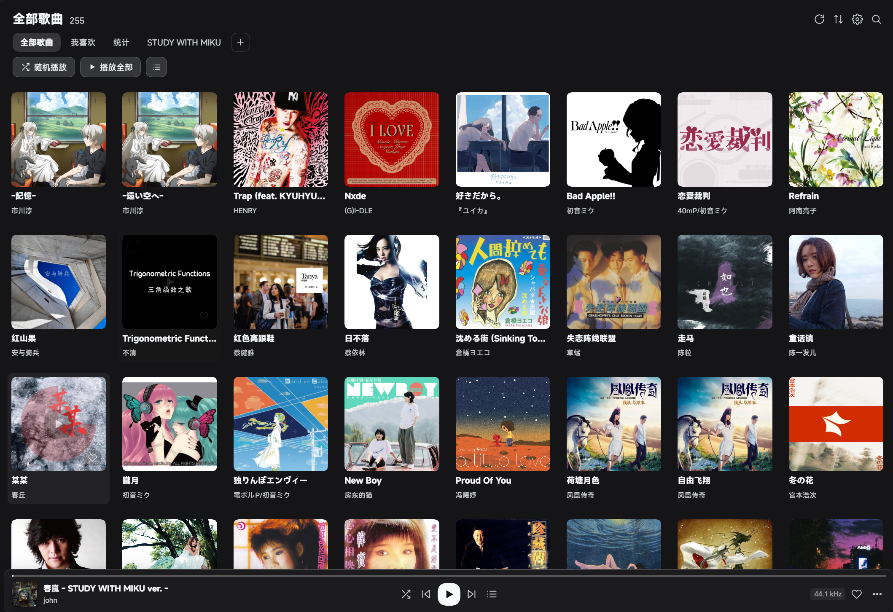
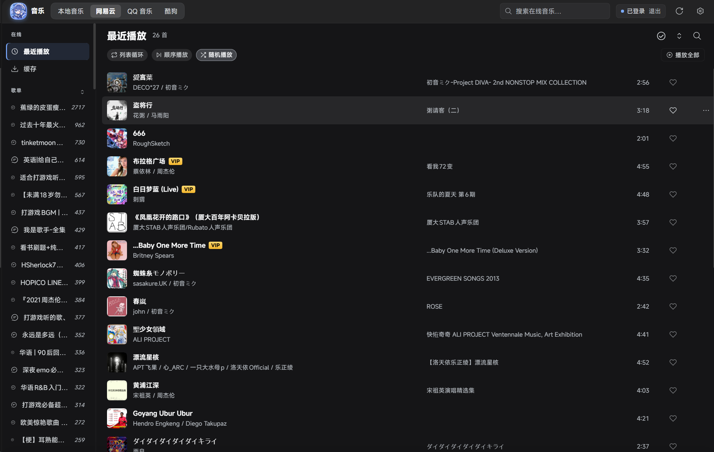
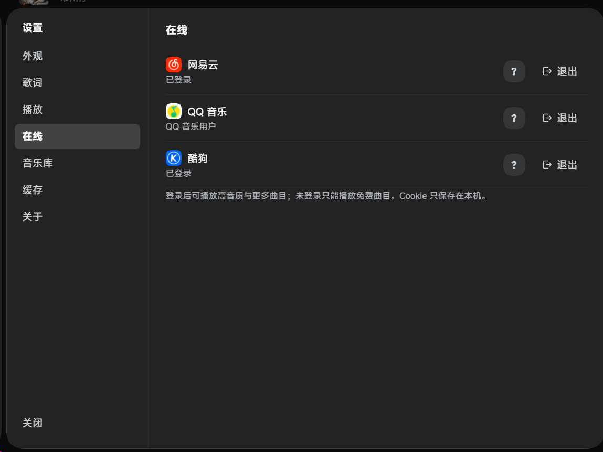
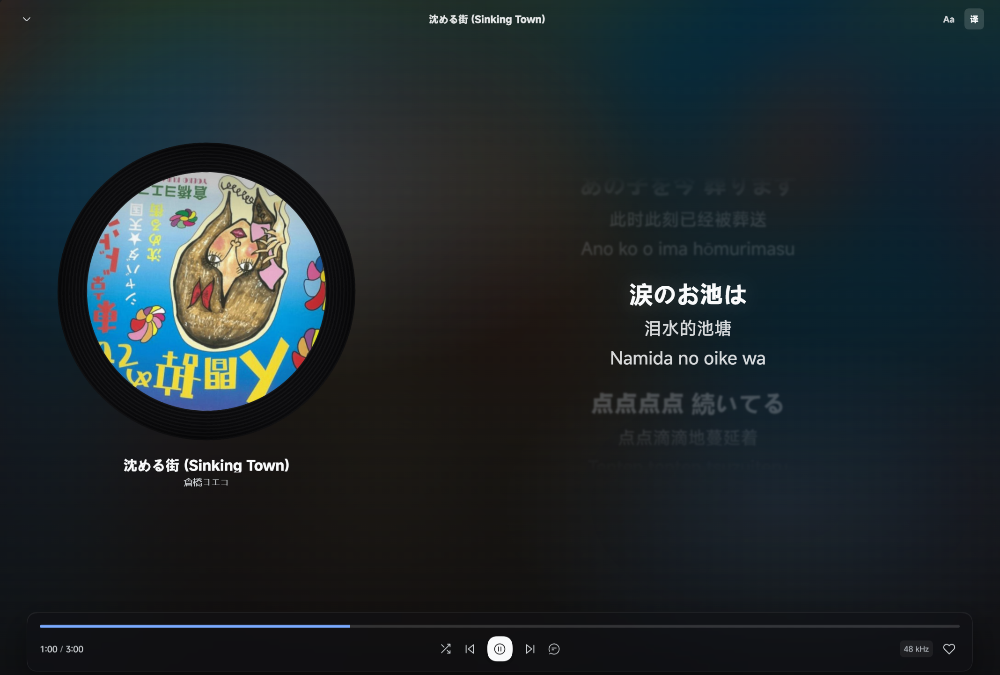
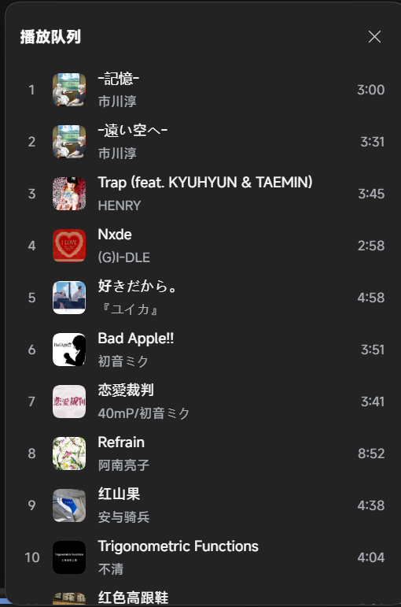
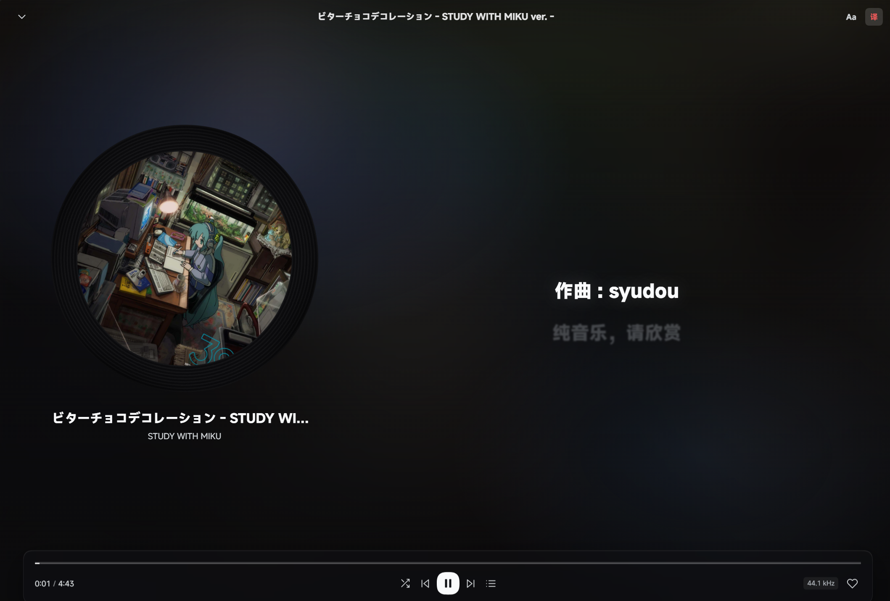

<div align="center">


# dsh-music-panel

**A local + online music player, natively embedded in DeepSeek Harness.**  
**在 DeepSeek Harness 里，把本地曲库、在线音乐平台和自建音乐服务器装进同一台播放器。**

Local library · NetEase Cloud Music · QQ Music · KuGou · Navidrome / Subsonic · Lyrics · Cache · EBU R128 · 10-band EQ  
本地曲库 · 网易云音乐 · QQ 音乐 · 酷狗 · Navidrome / Subsonic · 歌词 · 缓存 · 音量均衡 · 均衡器

[](https://www.npmjs.com/package/dsh-music-panel)
[](https://github.com/Aliboder/dsh-music-panel/releases)
[](https://github.com/Aliboder/dsh-music-panel/actions/workflows/ci.yml)
[](LICENSE)

[中文](#中文) · [English](#english)



</div>

---

## Screenshots · 截图

| Online playlists · 在线歌单 | Platform accounts · 平台账号 |
| :---: | :---: |
|  |  |

| Now playing · 播放页 | Queue · 播放队列 |
| :---: | :---: |
|  |  |

<details>
<summary>More screenshots · 更多截图</summary>

| Statistics · 播放统计 | Instrumental · 纯音乐播放页 |
| :---: | :---: |
|  |  |

| Settings · 设置 | Context menu · 右键菜单 |
| :---: | :---: |
|  |  |

| Batch actions · 批量操作 | Metadata matching · 在线匹配 |
| :---: | :---: |
|  |  |

| Light theme · 浅色 | Dark theme · 深色 |
| :---: | :---: |
|  |  |

</details>

---

## 中文

### 为什么是 dsh-music-panel

大多数音乐插件只做“能播”。`dsh-music-panel` 想做的是一台**真正属于 DSH 的播放器**：本地曲库、在线平台、歌词、缓存、元数据和播放统计共享同一套界面与队列，不需要在应用之间来回切换。

| | 能力 |
| :--- | :--- |
| **本地 + 在线** | 硬盘里的歌直接播；网易云 / QQ 音乐 / 酷狗的云端歌单与喜欢也能直接浏览和播放；Navidrome / Subsonic 自建库可接入。 |
| **像播放器，而不是列表** | 专辑网格、黑胶播放页、逐行歌词与翻译、可拖拽队列、播放统计、快速定位。 |
| **把在线歌单当本地歌单** | 歌单缓存 + 预取 + 后台校准，切走再切回不重新加载；支持按平台顺序 / 名称 / 歌曲数排序。 |
| **曲库维护留在窗口里** | 在线补全标签、替换封面、校准歌词、检测重复、回收站恢复，不用打开第三方工具。 |
| **为 DSH 原生设计** | 左侧栏入口、输入框上方歌词条、会话内播放控制，跟随宿主深浅色主题与组件规范。 |
| **只在你的机器上运行** | Cookie、缓存、播放记录全部保存在本机；客户端不直连外部域名。 |

### 功能

#### 本地曲库

- 多根目录扫描，可配置子文件夹深度；支持 MP3 / FLAC / M4A / AAC / OGG / OPUS / WAV / AIFF / WMA / APE。
- 歌曲 / 专辑 / 歌手 / 文件夹 / 喜欢 / 统计多种视图；按目录聚合并可单独隐藏。
- 列表循环、单曲循环、顺序播放、随机、上一首 / 下一首、进度拖动、音量与静音。
- 记忆上次播放曲目与进度，支持每首歌断点续播。
- 空格播放 / 暂停，`Ctrl` / `⌘` + `←` / `→` 切歌，`/` 聚焦搜索。

#### 在线音乐

- 顶栏一键切换本地音乐、网易云、QQ 音乐、酷狗、Navidrome / Subsonic；播放队列跨来源保留。
- 扫码登录后读取云端歌单、喜欢、最近播放；未登录也可播放平台免费曲目。
- **Navidrome / Subsonic**：设置 → 在线填写服务器地址、用户名和密码；搜索、播放、歌词、封面、收藏和歌单通过 Subsonic 标准接口完成。
- **完整曲库（可选）**：主动勾选「保存密码，启用完整曲库」后，使用 Navidrome 原生分页接口浏览全库；不勾选时使用随机采样的「全部歌曲」，不影响搜索和其他功能。
- **歌单歌曲缓存**：按 `provider + playlistId` 缓存 60 秒，导航项 hover / focus 预取；切回时先显示缓存，过期后后台校准。
- **在线歌单排序**：平台顺序 / 名称 / 歌曲数，偏好保存在本机。
- **账号资料**：设置 → 在线显示官方平台图标、当前昵称与头像；头像通过本机代理加载。
- **VIP 识别**：根据当前登录账号判断可播放性，VIP 曲目显示金色徽标。
- **音频缓存**：边播边写、播完落盘，默认上限 10 GB、LRU 淘汰；设置 → 缓存可查看全部缓存歌曲并清空。
- **可调歌词宽度**：播放页歌词栏两侧都可拖动调整宽度（双击复位），宽度按本机偏好保存。
- **两栏间距可调**：界面编辑里可调封面栏与歌词栏的间距（12–96px，默认 60px）。
- **动态流光背景**：播放页在封面色调上叠加缓慢流动的光晕，切歌时颜色平滑过渡，可在「界面编辑」关闭。
- **列表内搜索**：歌单 / 专辑 / 本地库右上角的放大镜点开后是当前列表的搜索框，按歌名、歌手、专辑实时过滤；顶部的全局搜索只负责在线搜索，两者互不干扰。
- **智能过渡**：播放页「音频效果 → 音量」或设置 → 播放，只有一个开关。播放到曲末前 14 秒时自动分析当前曲尾与下一首开头的响度，从安静点切入、按安静段长度决定重叠（2.5–6 秒），但**下一首只在重叠的最后 2.5 秒才淡入**（不会提前一大段就开始唱）；下一首一旦出声，界面（标题 / 封面 / 歌词 / 进度 / 队列）就切换到它；开启过渡时会在当前曲播放期间于后台预取下一首在线曲目，未缓存的在线歌曲不必等曲末 14 秒窗口才开始下载；只有真正静音的前奏（低于 -45 dBFS）才会被跳过，轻声前奏属于音乐内容会完整保留；**同专辑连续曲目固定保持原始衔接**；暂停、切歌、拖动进度会立即取消过渡。
- **音量均衡**：浏览器内置 EBU R128（BS.1770）分析，按曲目自动调整增益，不依赖 ffmpeg；首次分析后缓存结果。
- **均衡器**：播放页音量按钮里的「音频效果 → 均衡器」，10 段（31 / 62 / 125 / 250 / 500 / 1k / 2k / 4k / 8k / 16k Hz，Q=1.41，±12 dB）。「设备」页签内置约 8800 条 AutoEQ 耳机补偿曲线，可按型号搜索并套用（数据来源与许可见 [THIRD_PARTY_NOTICES.md](./THIRD_PARTY_NOTICES.md)）；出厂预设沿用 Winamp 原版 18 组曲线，可保存自己的曲线；“编辑”页有实时频响曲线、前置增益、自动 headroom 与输出限幅（多段提升不破音）。
- **列表内搜索**：歌单 / 专辑 / 本地库右上角的放大镜会展开成当前列表的搜索框，按歌名 / 歌手 / 专辑实时过滤；顶部全局搜索只负责在线搜索，两者互不干扰。
- 在线歌词与翻译：网易云 `trans`、QQ 加密翻译流、酷狗 KRC 内嵌译文；Navidrome / Subsonic 使用 OpenSubsonic 结构化歌词（如服务器支持）。

#### 歌词、元数据与整理

- 内嵌歌词与 `.lrc`，播放页逐行高亮、翻译、字号 / 粗细 / 模糊 / 对齐可调、±0.5s 偏移。
- 在线歌词搜索并写回内嵌歌词，写前自动备份。
- 在线匹配网易云 / QQ 音乐 / iTunes / MusicBrainz 元数据，支持整曲或单字段匹配。
- 编辑标题、艺术家、专辑、年份、音轨号、碟号、风格、专辑艺术家、作曲、作词、注释、歌词。
- 替换封面、检测重复、批量收藏 / 加入歌单 / 编辑 / 删除到回收站。
- 删除操作进入插件回收站，可按原路径恢复，不是永久删除。

### 安装

**要求：DSH Web / Desktop。** 插件需要浏览器载体播放音频，并使用宿主已配置的网络与存储。

#### 方式一：插件市场（推荐）

在 DSH 的 **插件市场** 搜索 `dsh-music-panel`，或让 Agent 执行：

```text
plugin_manager install_bundle dsh-music-panel
```

安装后**完整重启 DSH**，左侧栏出现音乐图标。

#### 方式二：npm

在 DSH profile 目录下：

```bash
pnpm add dsh-music-panel
```

然后重启 DSH。npm 包：<https://www.npmjs.com/package/dsh-music-panel>

#### 安装/升级后侧栏没有音乐图标？

先确认版本是 **0.27.3 或更高**。0.27.2 及更早版本缺少 `package.json` 的 `./package.json` 导出，DSH 会静默把插件判定为非客户端包：服务端工具可用，但浏览器端不会加载。

升级到 0.27.3+ 后：

1. **完整退出并重启 DSH**，不是只刷新页面。
2. 如果仍然没有图标，在插件市场把音乐插件关闭再开启一次。
3. 仍无效时，检查 profile 的 `cordis.patch.yml` 是否残留了禁用覆盖：

   ```yaml
   - id: music
     disabled: true
   ```

   删除这一段后重启。不要删除上面的 `- insert:` 音乐插件配置。
4. 插件管理器显示“已启用”但市场显示“已停用”，通常就是这条覆盖造成的；两层状态不一致时以 profile 最终应用的配置为准。

### 快速开始

**本地音乐**

1. 点击左侧栏音乐图标打开面板。
2. 右上角齿轮 → **音乐库**，添加一个或多个音乐文件夹。
3. 扫描完成后双击歌曲，或点「播放全部」。

**在线音乐**

1. 顶栏切到网易云 / QQ 音乐 / 酷狗，或选择 Navidrome / Subsonic。
2. 首次使用：齿轮 → **在线**，点对应平台「登录」，用手机 App 扫码确认；Navidrome 填写服务器地址、用户名和密码后连接。
3. 直接点导航里的云端歌单开始播放；播放过的歌曲会自动进入音频缓存。
4. 需要清理时到 **设置 → 缓存** 查看或清空。

Navidrome 的「全部歌曲」默认是随机采样。需要按页浏览完整曲库时，在连接表单中勾选「保存密码，启用完整曲库」；该选项会把密码额外写入本机 `providers.json`，详见下方隐私说明。

### 隐私

- 全部逻辑在本机运行；登录 Cookie、token 以及 Navidrome 的 salt + token 只写入 `~/.dsh/music/providers.json`（权限 0600）。
- Navidrome 默认只保存盐化 token。只有主动勾选「保存密码，启用完整曲库」时，密码才会以**明文**额外写入同一文件；这会扩大本机账户泄露后的影响面，请只在自己的机器上使用，并确保系统账户和磁盘加密可信。
- 缓存与播放记录位于 `~/.dsh/music/`，可随时清理。
- 客户端不向外部域名发请求：在线搜索、取链、歌词、封面均由 Host 发起并同源代理。

### 兼容与限制

- 仅支持 DSH Web / Desktop 宿主。
- 在线平台使用公开的非官方接口，可能失效、限流或改版；失败时会在界面提示，不影响本地播放。
- Navidrome / Subsonic 使用标准 Subsonic 接口，目前只在 Navidrome 0.64.2 上实测；Gonic / Airsonic / Supysonic 等兼容服务器理论上可用。
- Navidrome 的「完整曲库」使用其内部 `/api/song` 接口，可能随版本变化；失效时会退回随机采样，不影响搜索、播放和收藏。
- VIP / 付费曲目是否可播取决于当前登录账号，界面会显示金色徽标。
- 平台图标使用各平台 App Store 官方应用图标，仅用于平台识别，商标归各平台所有。

### 开发

```bash
npm test            # 32 test files
npm run check       # syntax + manifest checks
npm run pack:check  # package self-check
```

- Host：`index.js` + `lib/**`，提供 `/music/*` HTTP API。
- Web：`client.js` 由 `src/**` 分片构建，单文件、零运行时依赖，只依赖宿主注入的 `react`。

```bash
node scripts/build-client.mjs          # rebuild client.js
node scripts/build-client.mjs --check  # verify src and client.js agree
```

更多规范见 [主题与组件规范](docs/theme-guidelines.md) 与 [UI review](docs/ui-review-2026-11.md)。

### License

[MIT](LICENSE) © Aliboder

---

## English

### Why dsh-music-panel

Most music plugins stop at “it plays”. `dsh-music-panel` is built as a **real music player for DSH**: local files, online providers, lyrics, caching, metadata, and listening stats share one interface and one queue — no app switching.

| | What you get |
| :--- | :--- |
| **Local + online** | Play files from disk, browse cloud playlists from NetEase Cloud Music, QQ Music, and KuGou, or connect your own Navidrome / Subsonic server. |
| **A player, not just a list** | Album grid, vinyl now-playing view, synced lyrics with translations, draggable queue, listening stats, and “jump to current track”. |
| **Online playlists that feel local** | Per-playlist cache, hover prefetch, stale-while-revalidate refresh, and sorting by platform order / name / track count. |
| **Library maintenance in place** | Match metadata, replace covers, edit tags, calibrate lyrics, deduplicate tracks, and restore from trash. |
| **Native to DSH** | Sidebar entry, lyric line above the composer, in-conversation playback, host theme tokens, and light/dark support. |
| **Local by design** | Cookies, cache, and history stay on your machine; the browser side never calls external domains directly. |

### Features

#### Local library

- Multi-root scanning with configurable folder depth; MP3 / FLAC / M4A / AAC / OGG / OPUS / WAV / AIFF / WMA / APE.
- Songs, albums, artists, folders, favorites, and statistics views; folder grouping with per-folder hiding.
- Repeat modes, shuffle, previous / next, seek, volume, and mute.
- Restores the last track and position; optional per-track resume.
- `Space` play/pause, `Ctrl` / `⌘` + `←` / `→` previous/next, `/` focus search.

#### Online music

- Switch between local, NetEase, QQ Music, KuGou, and Navidrome / Subsonic from the top bar; the queue is shared across sources.
- QR sign-in for cloud playlists, favorites, and recent plays; free tracks work without signing in.
- **Navidrome / Subsonic**: enter the server URL, username, and password in Settings → Online. Search, streaming, lyrics, covers, favorites, and playlists use standard Subsonic endpoints.
- **Complete library (optional)**: opt into “Save password, enable complete library” to page the full library through Navidrome’s native API. Without it, “All songs” is a random sample; search and every other feature still work.
- **Playlist cache**: 60-second per-playlist cache with hover/focus prefetch. Reopening shows cached tracks immediately, then revalidates in the background.
- **Playlist sorting**: platform order / name / track count, persisted locally.
- **Account profiles**: official provider icons, nickname, and avatar in Settings → Online; avatars are proxied by the Host.
- **VIP awareness**: playability follows the signed-in account; VIP tracks are marked.
- **Audio cache**: write-while-playing, default 10 GB with LRU eviction; Settings → Cache lists every cached track across providers.
- **Volume leveling**: built-in EBU R128 / BS.1770 analysis with per-track gain, no ffmpeg required; results are cached.
- **10-band equalizer**: Audio effects → Equalizer in the player bar (31 / 62 / 125 / 250 / 500 / 1k / 2k / 4k / 8k / 16k Hz, Q=1.41, ±12 dB). The Devices tab ships ~8,800 AutoEQ headphone correction curves with model search; factory presets reuse Winamp’s 18 curves; the Edit tab has a live response curve, preamp, and automatic headroom + limiter.
- **Smart transition**: one switch in Audio effects → Volume (or Settings → Playback). It analyses the end of the current track and the start of the next, then blends with an equal-power curve for 2.5–6 s; the next track only fades in during the last 2.5 s, and the UI switches the moment it becomes audible. Album tracks keep their original join; pause, seek, or next cancels the blend.
- **In-list search**: the magnifier in a playlist, album, or library header expands into a search field for the list you are looking at (title / artist / album); the top-bar search stays dedicated to online search.
- Online lyrics and translations for the Chinese providers; Navidrome / Subsonic uses OpenSubsonic structured lyrics when the server provides them.

#### Lyrics, metadata, and cleanup

- Embedded lyrics and `.lrc`; line highlighting, translation, typography controls, alignment, and ±0.5s offset.
- Online lyric search with backup before writing.
- Metadata matching via NetEase / QQ Music / iTunes / MusicBrainz, whole-track or per-field.
- Edit title, artist, album, year, track/disc number, genre, album artist, composer, lyricist, comment, and lyrics.
- Cover replacement, duplicate detection, batch favorite / add-to-playlist / edit / trash.
- Deletions go to the plugin trash and can be restored by original path.

### Install

**Requires DSH Web / Desktop.** A browser runtime is needed for playback.

**Plugin marketplace (recommended)**

Search for `dsh-music-panel` in DSH, or run:

```text
plugin_manager install_bundle dsh-music-panel
```

Then **restart DSH completely**. A music icon appears in the sidebar.

**npm**

From the DSH profile directory:

```bash
pnpm add dsh-music-panel
```

Then restart DSH. Package: <https://www.npmjs.com/package/dsh-music-panel>

#### No music icon after install/upgrade?

First check the version: **0.27.3 or newer**. Versions up to 0.27.2 lacked the `./package.json` export, so DSH silently treated the package as a non-client package: the Host tool worked, but the browser bundle never loaded.

For 0.27.3+:

1. **Quit and restart DSH completely** — a page refresh is not enough.
2. If the icon is still missing, disable and re-enable the music plugin from the plugin marketplace.
3. If that does not help, check the profile's `cordis.patch.yml` for a stale disable override:

   ```yaml
   - id: music
     disabled: true
   ```

   Remove that block and restart. Do not remove the `- insert:` music entry above it.
4. “Enabled” in the plugin manager and “Disabled” in the marketplace usually means this override is present; the final profile composition wins.

### Quick start

1. Open the music panel from the sidebar.
2. Settings → **Library**, add one or more music folders.
3. Double-click a track, or press “Play all”.
4. For online music, switch to a provider and sign in via QR in Settings → **Online**; for Navidrome/Subsonic, enter the server URL, username, and password.
5. Open a cloud playlist or your server library from the navigation; played tracks are cached automatically.

Navidrome’s “All songs” view is a random sample by default. To page the complete library, enable “Save password, enable complete library” in the connection form; that stores the password in the local `providers.json` (see Privacy).

### Privacy

- Everything runs locally. Cookies, tokens, and Navidrome’s salt + token are stored only in `~/.dsh/music/providers.json` (mode 0600).
- Navidrome stores only a salted token by default. If you opt into “Save password, enable complete library”, the password is additionally written **in plaintext** to the same file; this increases the impact of a local account compromise. Use it only on a machine you trust, with a protected OS account and disk encryption.
- Cache and history live under `~/.dsh/music/` and can be cleared at any time.
- The browser side never calls external domains: search, stream resolution, lyrics, and covers are proxied by the Host.

### Limitations

- DSH Web / Desktop only.
- Online providers use public, unofficial APIs; they may change, throttle, or break. Failures are surfaced in the UI and do not affect local playback.
- Navidrome / Subsonic uses standard Subsonic endpoints and is currently tested only against Navidrome 0.64.2; Gonic / Airsonic / Supysonic and other compatible servers are expected to work.
- Navidrome’s complete-library view uses its internal `/api/song` endpoint, which may change between versions; if it fails, the panel falls back to random sampling without affecting search, playback, or favorites.
- VIP / paid track availability depends on the signed-in account and is marked in the UI.
- Provider icons come from the official App Store artwork and are used only for identification; trademarks belong to their owners.

### Development

```bash
npm test
npm run check
npm run pack:check
```

- Host: `index.js` + `lib/**`, exposing `/music/*` HTTP routes.
- Web: `client.js` is built from `src/**` as a single CJS module with no runtime dependencies beyond the host-provided `react`.

```bash
node scripts/build-client.mjs
node scripts/build-client.mjs --check
```

See [theme guidelines](docs/theme-guidelines.md) and [UI review](docs/ui-review-2026-11.md) for conventions.

### Credits

- [AutoAnimate](https://github.com/formkit/auto-animate) (MIT) powers the now-playing track transitions.

### License

[MIT](LICENSE) © Aliboder


