<div align="center">

# 🎵 dsh-music-panel

**在 DeepSeek Harness 里，把本地曲库和三个在线音乐平台装进同一台播放器。**

本地扫描 · 歌词翻译 · 元数据编辑 · 在线播放（网易云 / QQ 音乐 / 酷狗）· 音频缓存 · 纯本地运行

[](https://www.npmjs.com/package/dsh-music-panel)
[](https://github.com/Aliboder/dsh-music-panel/actions/workflows/ci.yml)
[](LICENSE)
[](https://github.com/Aliboder/dsh-music-panel)

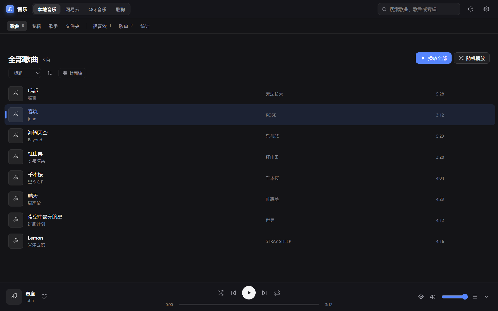

</div>

---

> **0.25.1**：多音乐目录与单目录隐藏、喜欢红心、在线云端喜欢 / 加入歌单、底栏压缩 + 全宽进度条 + 队列浮窗、缓存列表与歌单列表同款（封面 / 歌手 / 专辑 / 时长）。

## ✨ 为什么是它

- **本地 + 在线，一个面板。** 自己的歌在硬盘里直接播；想听平台曲库时切到网易云 / QQ 音乐 / 酷狗，不用另开客户端。
- **像个正经播放器。** 列表视图、播放页黑胶、逐行歌词（含翻译）、队列拖拽、播放统计、右下角定位，一样不少。
- **窗口里就能整理曲库。** 在线补全元数据、替换封面、改标签、校准歌词、清理重复——不用离开 DSH。
- **在线播放不将就。** 扫码登录、云端歌单、喜欢、最近播放、VIP 识别、歌词翻译、音频缓存都做了，且只在你自己的机器上运行。
- **为 DSH 而生。** 左侧栏音符入口、输入框上方歌词条、会话内直接控制播放，和 Harness 融为一体。

## 📸 截图

| 播放页 · 黑胶 + 歌词 | 播放队列浮窗 |
| :---: | :---: |
| 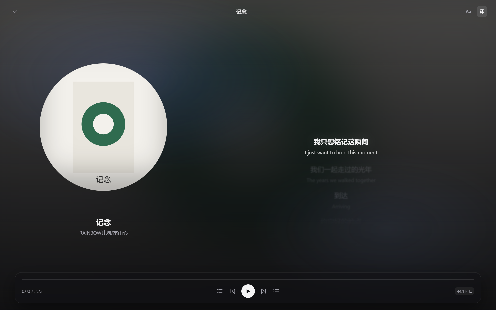 | 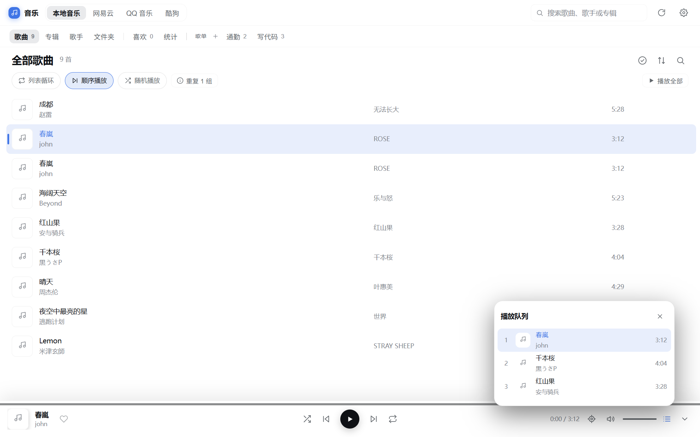 |

<details>
<summary>更多截图</summary>

| 设置 · 布局切换 | 右键菜单 |
| :---: | :---: |
| 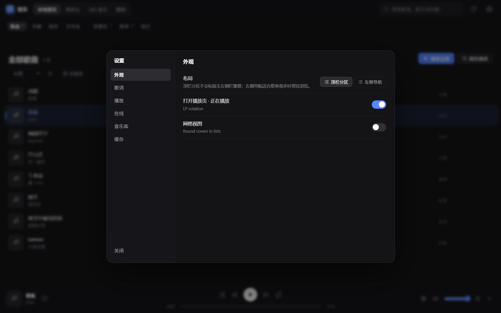 | 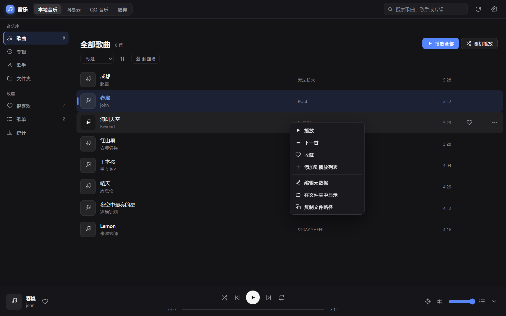 |

| 多选与批量 | 标签在线匹配 |
| :---: | :---: |
| 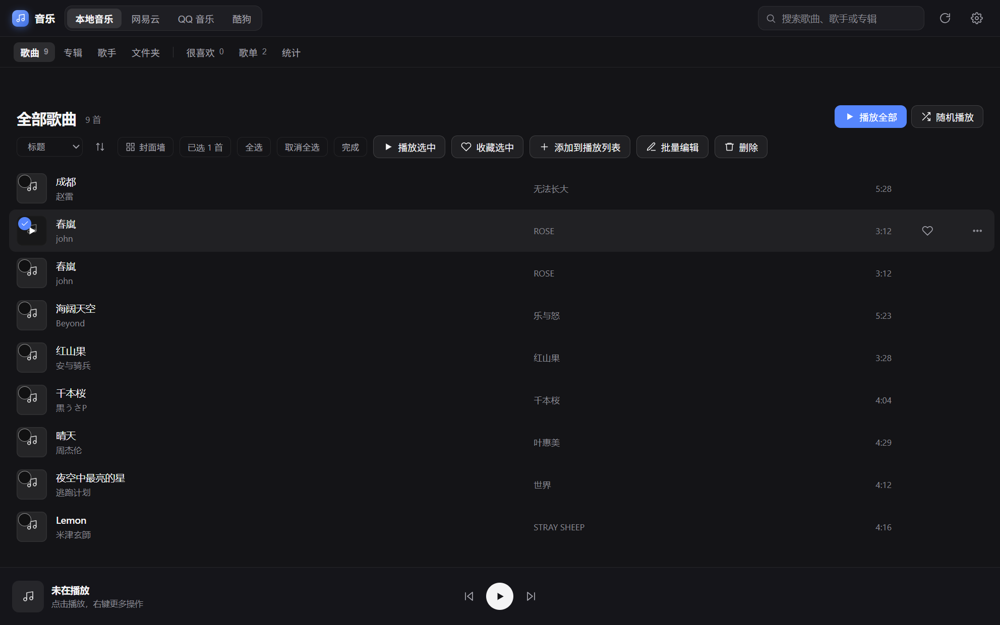 | 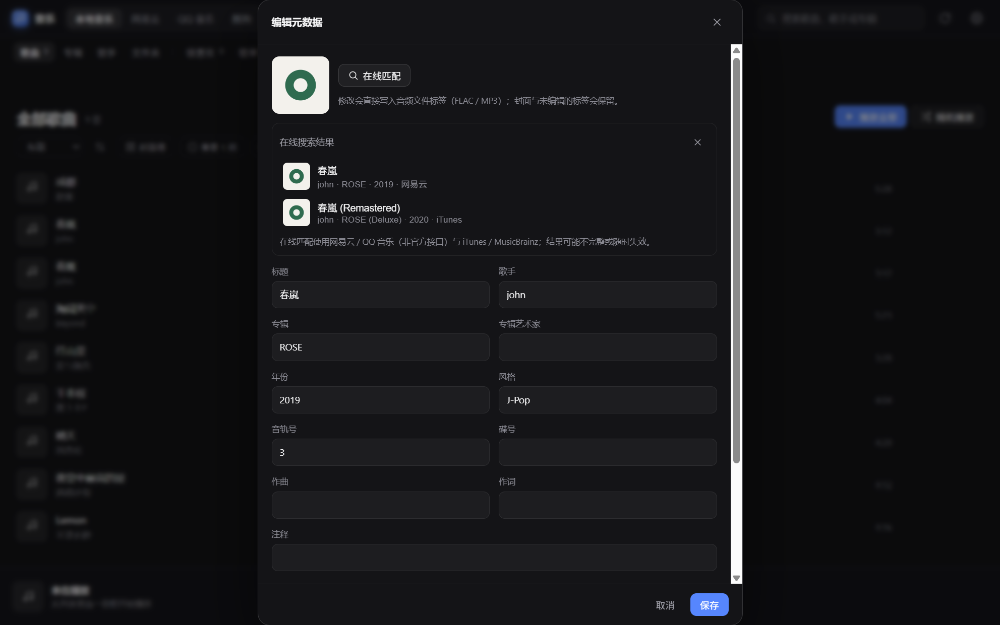 |

| 列表多选 | 回收站 |
| :---: | :---: |
|  | 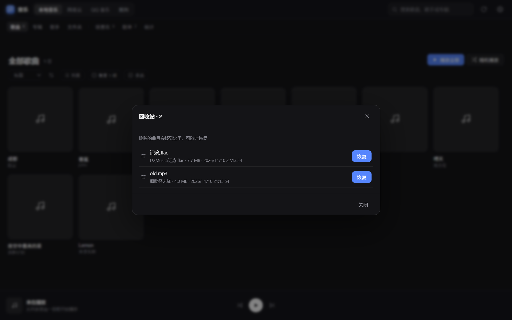 |

| 新顶栏 | 选择菜单 |
| :---: | :---: |
| 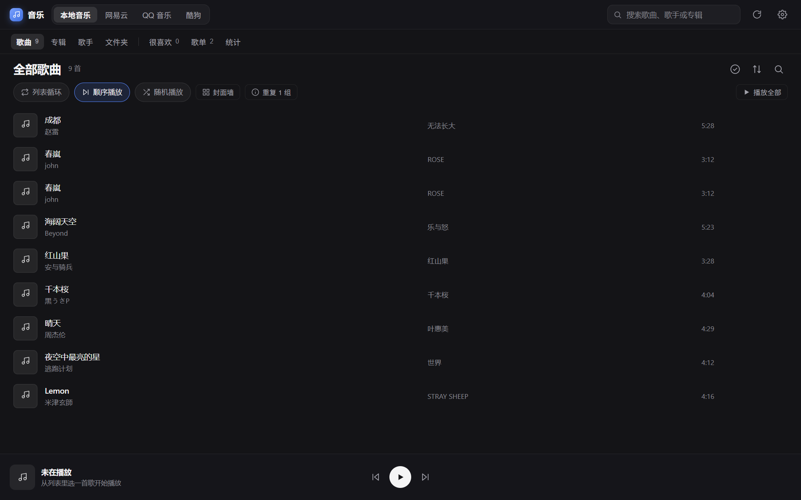 | 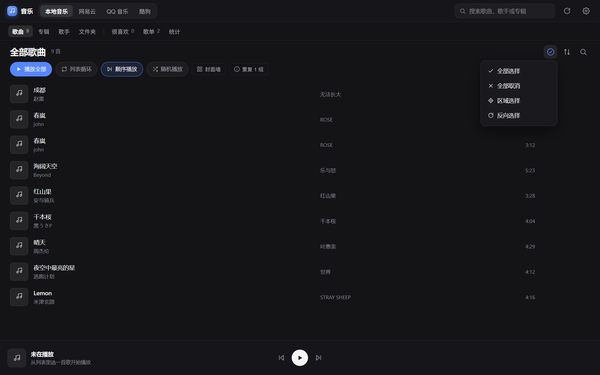 |

| 浅色主题 | 深色主题 |
| :---: | :---: |
| 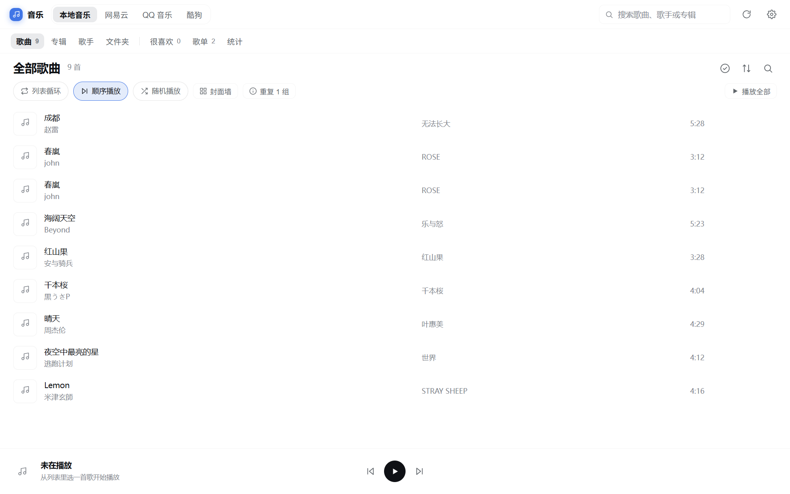 | 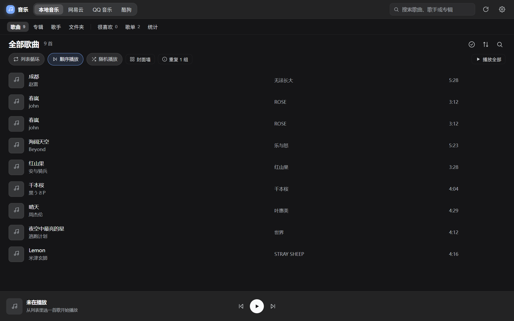 |

</details>

## 🎧 功能一览

### 曲库与播放（本地）

- **两种导航布局**：默认「顶栏分区」不会再和 DSH 自带左侧栏重复；想要常驻导航可在 **设置 → 外观 → 布局** 切成「左侧导航」
- **单击选中、双击播放**：封面上的播放按钮单击即播；勾选圈或 Ctrl / Cmd + 单击可多选
- 扫描你指定的音乐文件夹（可配置子文件夹深度），支持多个根目录；「文件夹」视图可直接添加，也可以按目录单独隐藏歌曲；支持 MP3 / FLAC / M4A / AAC / OGG / OPUS / WAV / AIFF / WMA / APE
- 歌曲列表视图，按播放时长、次数、最近播放排序
- **按文件夹分组**：「文件夹」视图按真实目录聚合，标题显示目录名、下方显示完整路径，点文件夹即可只看该目录的歌曲
- 播放控制：列表循环 / 单曲循环 / 不循环、随机、上一首 / 下一首、进度拖动、音量与静音
- 队列浮窗：点底栏按钮在按钮上方弹出，拖拽排序、移除、点击跳播
- 快捷键：空格播放 / 暂停、Ctrl/⌘ + ←/→ 上一首 / 下一首、`/` 聚焦搜索
- 记忆上次播放曲目与进度、每首歌断点续播

### 在线音乐（网易云 / QQ 音乐 / 酷狗）

- **一个面板三个来源**：顶栏「本地音乐 / 网易云 / QQ 音乐 / 酷狗」随时切换，播放队列跨来源保留
- **歌单直接作为导航项**：本地/在线都一样，每个歌单单独一条，不再先进入「歌单」列表页；本地歌单区带「+ 新建」，右键歌单可删除
- **云端喜欢 / 加入歌单**：在线歌曲行内红心和右键菜单都写回账号云端；右键「添加到歌单」可直接选账号里的云端歌单
- **最近播放**：记录你在该平台的收听历史，支持右键单曲移除、一键「清除无法播放」（批量检测并移除 VIP / 已下架曲目）
- **扫码登录**：设置 → 在线，三平台扫码登录；登录态只保存在本机（`~/.dsh/music/providers.json`，权限 0600）
- **音质**：统一标准档（各平台 128k 级别），不提供额外选项；实际取链失败会给出提示
- **歌词与翻译**：自动加载平台歌词；网易云直接取 `trans`，QQ 解析 `GetPlayLyricInfo` 的加密翻译流，酷狗解析 KRC 内嵌译文——开关翻译即可看到双语
- **VIP / 付费标识**：在线曲目行显示金色 VIP 徽标；点 VIP 曲目会提示不可播，播放队列只收录能听的歌
- **音频缓存**：边播边写临时文件，播完重命名落盘（不占整首内存）；默认上限 **10 GB**，LRU 淘汰；已缓存歌曲显示下载图标，可在设置 → 在线 → 缓存列表查看与单首删除
- **播放体验**：Host 取链 + 同源代理，转发 Range 并返回 206；客户端先取整首到 `blob` 再播放，拖动进度条与本地文件一致
- **快速定位**：右下角浮动按钮，点击切到正在播放歌曲所属的平台/歌单并滚动到该行

### 歌词

- 内嵌歌词（MP3 ID3 USLT / FLAC Vorbis LYRICS）与 `.lrc` 文件，来源顺序可调
- 播放页逐行高亮、翻译显示、字号 / 粗细 / 模糊 / 对齐可调、±0.5s 偏移校准
- 在线歌词搜索：按歌名 / 艺术家搜索候选，预览后写入内嵌歌词（写前自动备份）
- 输入框上方歌词条：歌名 · 实时频谱 · 当前唱词

### 元数据与封面

- 在线匹配元数据（网易云 / QQ 音乐 / iTunes / MusicBrainz），支持整曲匹配与单字段匹配
- 编辑标题、艺术家、专辑、年份、音轨号、碟号、风格、专辑艺术家、作曲、作词、注释、歌词
- 替换封面（在线匹配结果），写回时临时文件 + 回读校验 + 原子替换，失败不破坏原文件
- 重复歌曲检测：按音质（码率 → 采样率 → 文件大小）保留最好的一首，其余移入插件回收站；**设置 → 音乐库 → 回收站** 可按原路径恢复`n- 多选与批量操作：右键选中项即可批量收藏 / 加入歌单 / 编辑元数据 / 删除到回收站，标题旁显示已选数量

### 其他

- 喜欢（红心）、歌单（新建 / 增删歌曲 / 右键删除）、播放统计（累计时长、次数、收听排行）
- 睡眠定时（显示剩余时间，设置里或播放条上一键取消）、播放设置页（启动恢复 / 自动播放 / 断点续播）
- 跟随 DSH 深浅色主题；深色模式完整适配

## 🚀 安装

### 方式一：DSH 插件市场（推荐）

在 DSH 的 **插件市场** 中搜索 `dsh-music-panel` 安装，或让 Agent 执行：

```
plugin_manager install_bundle dsh-music-panel
```

安装后重启 DSH（Host 代码需要重启加载），左侧栏出现音符图标。

### 方式二：npm 安装

```bash
# 在 DSH profile 目录下
pnpm add dsh-music-panel
```

## ⚡ 快速开始

### 本地音乐

1. 点击左侧栏 **音乐** 图标，打开音乐面板
2. 右上角 **齿轮 → 音乐库**，点「+ 添加文件夹」，在目录选择器里浏览并选择你的音乐目录
3. 回到主面板，曲库自动扫描完成
4. 双击任意歌曲播放，或点「播放全部」

### 在线音乐

1. 顶栏切到 **网易云 / QQ 音乐 / 酷狗**
2. 首次使用：**齿轮 → 在线**，点对应平台的「登录」，用手机 App 扫码确认（QQ 可选微信扫码）
3. 未登录也能播平台免费曲目；登录后可听更高码率（仍统一标准档位）并访问「我的歌单」
4. 本地/在线的每个歌单都直接作为导航项，点一下切换内容区；本地歌单可右键删除
5. 播放过的在线歌曲会自动缓存，下次秒开；缓存可在 **设置 → 在线 → 缓存列表** 管理

## ⌨️ 快捷键

| 按键 | 功能 |
| :--- | :--- |
| `空格` | 播放 / 暂停 |
| `Ctrl` / `⌘` + `←` | 上一首 |
| `Ctrl` / `⌘` + `→` | 下一首 |
| `/` | 聚焦搜索框 |
| `Esc` | 关闭播放页 / 队列 / 弹窗 |

## 🎨 主题与组件规范

新增或修改界面前先读 [`docs/theme-guidelines.md`](docs/theme-guidelines.md)：

- 颜色 / 圆角 / 字号 / 焦点环 / 菜单材质一律取 `--dsw-*` token，浅色与深色都必须成立
- 对话框用 `KitModal`、开关用 `Switch`、胶囊用 `KitPill`、菜单用 `HeadMenu`，不要手写第二套
- 宿主组件可用时优先宿主实现，缺失时自动回退；状态在 **设置 → 外观 → 宿主组件** 查看
- 新图标优先加入 `HOST_ICON_MAP`；音乐专用图标（上一首/下一首/随机/循环/音量/音符）保留本地 SVG
- 交互审计与已知问题：[docs/ui-review-2026-11.md](docs/ui-review-2026-11.md)

## 🛠️ 给开发者

- 宿主端 `index.js` + `lib/**` 提供本地 HTTP API（`/music/*`）：曲库扫描、封面、歌词、标签读写、在线匹配、在线歌词、在线播放代理、缓存、统计、回收站
- Web 端 `client.js` 由 `src/` 分片构建生成（零运行时依赖，仍是 `window.__ModuleLoader__` 单文件、CJS 包装、只依赖宿主注入的 `react`）：
  ```bash
  node scripts/build-client.mjs          # 重新生成 client.js
  node scripts/build-client.mjs --check  # CI：产物是否与 src 一致
  ```
  构建脚本会检测跨分片重复的顶层声明，避免 0.11 里出现过的重复 `useState` / 重复函数。
- 在线播放链路：`/music/online/search|playlist-songs|stream|lyric|login/*`；流代理转发 `Range` 并回 `206`，支持拖动进度条
- 全部逻辑可测试：17 个测试文件覆盖扫描、配置、歌词、标签、在线匹配、缓存、统计、路由、客户端模块形态、**面板渲染冒烟**

```bash
npm test          # 单元测试
npm run check     # 语法 / 清单检查
npm run pack:check # 打包自检
```

### 在线接口说明

在线播放使用各平台公开的**非官方接口**（与开源播放器相同的取链方式），不保证长期可用：

| 平台 | 取链 | 歌单 | 翻译 |
| :--- | :--- | :--- | :--- |
| 网易云 | weapi / linuxapi / eapi | ✅ 我创建的 + 收藏 | ✅ 接口自带 `trans` |
| QQ 音乐 | musicu.fcg + vkey | ✅ 我喜欢 + 收藏 | ✅ `GetPlayLyricInfo` 的加密 `data.trans` |
| 酷狗 | gateway.kugou.com + 设备注册 | ✅ 云歌单 + 收藏 | ✅ KRC 内嵌 `translations` |

缓存目录：`~/.dsh/music/cache/online/<平台>/<id>.audio`；同目录还有 `<id>.info.json`（标题/歌手/专辑/封面/时长）与 `<id>.lyric.json`，封面在 `cache/online/assets/`。清空或单删不会影响播放记录。

## 🔒 隐私与数据

- **全部在本机运行**：登录 Cookie / token 只写入 `~/.dsh/music/providers.json`（0600），不会上传到任何服务器
- 缓存与播放记录同样在 `~/.dsh/music/`，随时可清空
- 插件不在客户端向外部域名发请求：在线请求全部由 Host 发起并同源代理

## ⚠️ 兼容与限制

- 仅支持 DSH Web / Desktop 宿主（需要浏览器载体才能播放）
- 在线平台接口为非官方接口，可能失效、限流或改版；失效时会在界面提示，不影响本地播放
- VIP / 付费曲目默认不加入队列（显示金色徽标），未登录只能播放免费曲目
- 删除重复走「插件回收站」`<DSH_HOME>/music/trash/`，不是永久删除

## 📄 License

[MIT](LICENSE) © Aliboder


