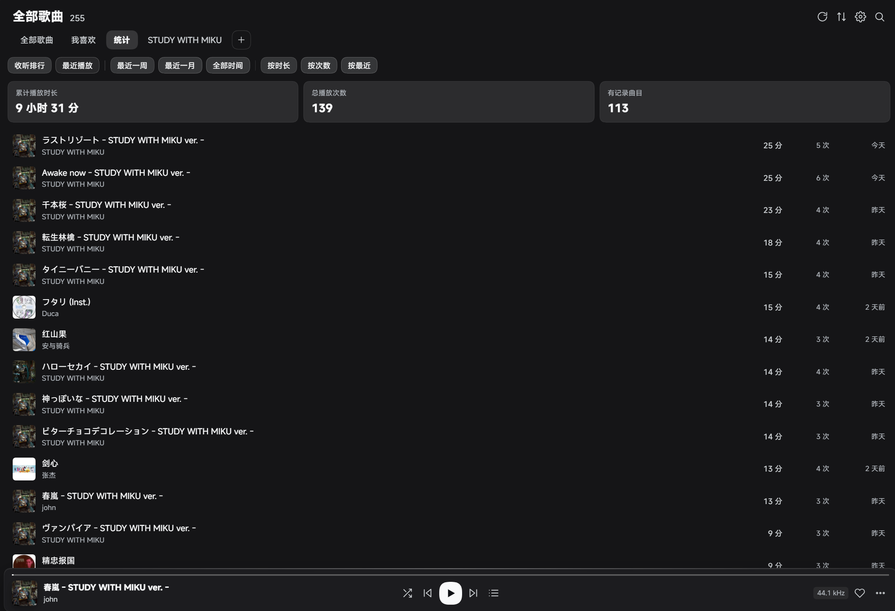

<div align="center">

# 🎵 dsh-music-panel

**在 DeepSeek Harness 里，把你自己的音乐库变成一台完整的播放器。**

本地扫描 · 封面墙 · 歌词 · 元数据编辑 · 播放统计 · 纯本地运行

[](https://www.npmjs.com/package/dsh-music-panel)
[](https://github.com/Aliboder/dsh-music-panel/actions/workflows/ci.yml)
[](LICENSE)
[](https://github.com/Aliboder/dsh-music-panel)


</div>

---

## ✨ 为什么是它

- **你的歌，你的硬盘。** 不依赖任何在线音乐平台：不上传文件、不请求云端曲库，断网也能听。
- **像个正经播放器。** 封面墙、播放页黑胶、逐行歌词、队列拖拽排序、播放统计，一样不少。
- **窗口里就能整理曲库。** 在线补全元数据、替换封面、改标签、校准歌词、清理重复——不用离开 DSH。
- **为 DSH 而生。** 左侧栏音符入口、输入框上方歌词条、会话内直接控制播放，和 Harness 融为一体。

## 📸 截图

| 播放页 · 黑胶 + 歌词 | 播放统计 |
| :---: | :---: |
|  |  |

<details>
<summary>更多截图</summary>


</details>

## 🎧 功能一览

### 曲库与播放
- 扫描你指定的音乐文件夹（可配置子文件夹深度），支持 MP3 / FLAC / M4A / AAC / OGG / OPUS / WAV / AIFF / WMA / APE
- 歌曲列表与封面网格两种视图，按播放时长、次数、最近播放排序
- 播放控制：列表循环 / 单曲循环 / 不循环、随机、上一首 / 下一首、进度拖动、音量与静音
- 队列面板：拖拽排序、移除、点击跳播；底栏按钮弹出、位置锚定按钮旁边
- 快捷键：空格播放 / 暂停、Ctrl/⌘ + ←/→ 上一首 / 下一首、`/` 聚焦搜索
- 记忆上次播放曲目与进度、每首歌断点续播

### 歌词
- 内嵌歌词（MP3 ID3 USLT / FLAC Vorbis LYRICS）与 `.lrc` 文件，来源顺序可调
- 播放页逐行高亮、翻译显示、字号 / 粗细 / 模糊 / 对齐可调、±0.5s 偏移校准
- **在线歌词搜索**：按歌名 / 艺术家搜索候选，预览后写入内嵌歌词（写前自动备份）
- 输入框上方歌词条：歌名 · 实时频谱 · 当前唱词

### 元数据与封面
- 在线匹配元数据（网易云 / QQ 音乐 / iTunes / MusicBrainz），支持整曲匹配与单字段匹配
- 编辑标题、艺术家、专辑、年份、音轨号、碟号、风格、专辑艺术家、作曲、作词、注释、歌词
- 替换封面（本地图片 / 在线封面），写回时临时文件 + 回读校验 + 原子替换，失败不破坏原文件
- 重复歌曲检测：按音质（码率 → 采样率 → 文件大小）保留最好的一首，其余移入插件回收站（可恢复）

### 其他
- 喜欢列表、歌单（新建 / 重命名 / 增删歌曲）、播放统计（累计时长、次数、收听排行）
- 睡眠定时、播放设置页（启动恢复 / 自动播放 / 断点续播）
- 跟随 DSH 深浅色主题；深色模式完整适配

## 🚀 安装

### 方式一：DSH 插件市场（推荐）

在 DSH 的 **插件市场** 中搜索 `dsh-music-panel` 安装，或让 Agent 执行：

```
plugin_manager install_bundle dsh-music-panel
```

安装后重启 DSH（Host 代码需要重启加载），左侧栏出现音符图标。

### 方式二：npm 安装

```bash
# 在 DSH profile 目录下
pnpm add dsh-music-panel
```

## ⚡ 快速开始

1. 点击左侧栏 **音乐** 图标，打开音乐面板
2. 右上角 **齿轮 → 音乐库**，点「+ 添加文件夹」，选择你的音乐目录
3. 回到主面板，曲库自动扫描完成
4. 双击任意歌曲播放，或点「播放全部」

> 歌词、封面、元数据都会自动从文件里读取；缺什么可以点右键 →「编辑元数据」或「在线歌词」补齐。

## ⌨️ 快捷键

| 按键 | 功能 |
| :--- | :--- |
| `空格` | 播放 / 暂停 |
| `Ctrl` / `⌘` + `←` | 上一首 |
| `Ctrl` / `⌘` + `→` | 下一首 |
| `/` | 聚焦搜索框 |
| `Esc` | 关闭播放页 / 队列 / 弹窗 |

## 🛠️ 给开发者

- 宿主端 `index.js` + `lib/**` 提供本地 HTTP API（`/music/*`）：曲库扫描、封面、歌词、标签读写、在线匹配、在线歌词、统计、回收站
- Web 端 `client.js` 零构建，通过 `window.__ModuleLoader__` 加载，CJS 包装，只依赖宿主注入的 `react`
- 全部逻辑可测试：14 个测试文件覆盖扫描、配置、歌词、标签、在线匹配、统计、路由等

```bash
npm test          # 单元测试
npm run check     # 语法 / 清单检查
npm run pack:check # 打包自检
```

## ⚠️ 兼容与限制

- 仅支持 DSH Web / Desktop 宿主（需要浏览器载体才能播放）
- 在线能力（元数据、歌词）使用第三方非官方接口，可能失效或被限流；离线时自动回退到本地标签
- 删除重复走「插件回收站」`<DSH_HOME>/music/trash/`，不是永久删除

## 📄 License

[MIT](LICENSE) © Aliboder
